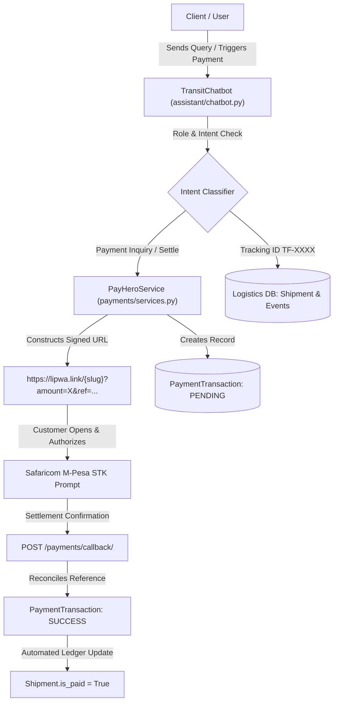

# TransitFlow Deliverables & System Logic Guide

## 📦 Downloadable Files

The requested deliverables have been generated and staged for download:

### 1. Main Project Codebase (ZIP)
Cleaned Django logistics project with the enhanced PayHero Lipwa Link chatbot payment integration (and the in-app how-to guide extracted):
* **Artifact Download:** [transitflow_project.zip](file:///home/yourname/.gemini/antigravity/brain/44da9fad-17ca-4e47-b917-723d4c5a3d2b/transitflow_project.zip)
* **Desktop File:** [transitflow_project.zip](file:///home/yourname/Desktop/transitflow_project.zip)
* **Size:** ~103 KB (excludes temporary `.pyc`, `venv`, and `__pycache__` artifacts)

### 2. PayHero Lipwa Link Developer Guide (PDF)
Standalone, printable developer integration manual detailing account setup, channel linking, dynamic query parameter structures, programmatic STK push API, and webhook reconciliation:
* **Artifact Download:** [PayHero_Lipwa_Link_Guide.pdf](file:///home/yourname/.gemini/antigravity/brain/44da9fad-17ca-4e47-b917-723d4c5a3d2b/PayHero_Lipwa_Link_Guide.pdf)
* **Desktop File:** [PayHero_Lipwa_Link_Guide.pdf](file:///home/yourname/Desktop/PayHero_Lipwa_Link_Guide.pdf)
* **Format:** Formatted A4 PDF with parameter tables and Python code snippets

---

## 🏛️ System Core Logic & Architecture (Programmer's Perspective)



### 1. Architectural Principles
- **Framework:** Django 6.1 on Python 3.13.
- **Service-Oriented Decoupling:** Business domain logic is decoupled from HTTP presentation layers. PayHero interactions reside in `payments/services.py`, NLP logic in `assistant/chatbot.py`, and domain validation in `logistics/models.py`.
- **Role Isolation (RBAC):** Strict query-level filtering prevents cross-tenant data leakage.

### 2. Core Modules Breakdown

| App / Module | Primary Responsibility | Key Classes / Functions |
| :--- | :--- | :--- |
| `core` | Identity, session management, and RBAC | `User`, `UserRole`, `RoleSessionMiddleware` |
| `logistics` | Cargo tracking, cold-chain bounds, routes | `Shipment`, `Product`, `TransitEvent` |
| `payments` | Financial ledger, PayHero API, Webhooks | `PayHeroService`, `PayHeroConfig`, `PaymentTransaction` |
| `assistant` | Privilege-aware AI chatbot assistant | `TransitChatbot`, `chatbot_message_api` |

### 3. Key Workflows

#### A. Chatbot Payment Generation
1. When a client asks to pay an invoice, `TransitChatbot.process_query()` checks the client's unpaid shipments.
2. It calls `PayHeroService.generate_lipwa_link()`, generating a unique reference (`PAY-TF-XXXXXXXX`) and constructing the query-parameterized link:
   ```
   https://lipwa.link/{slug}?amount={fee}&phone={phone}&name={name}&channel_id={id}&reference={ref}&success_url={success}&failed_url={failed}
   ```
3. A pending `PaymentTransaction` is logged to the database.
4. The assistant sends back a formatted card with a direct click-to-pay button that opens the payment link in a new browser tab.

#### B. Cold-Chain Monitoring
1. Products marked `PERISHABLE` specify `min_temp_celsius` and `max_temp_celsius`.
2. As checkpoints are logged by drivers or porters in `TransitEvent`, temperature readings are audited against product limits.
3. If an excursion is detected, the shipment state flips to `TEMP_ALERT` automatically.

#### C. Asynchronous Webhook Reconciliation
1. Following M-Pesa PIN authorization, PayHero dispatches a JSON `POST` payload to `/payments/callback/`.
2. The view validates the payload, queries `PaymentTransaction` by `external_reference`, records the `MpesaReceiptNumber`, marks status as `SUCCESS`, and updates `Shipment.is_paid = True`.
